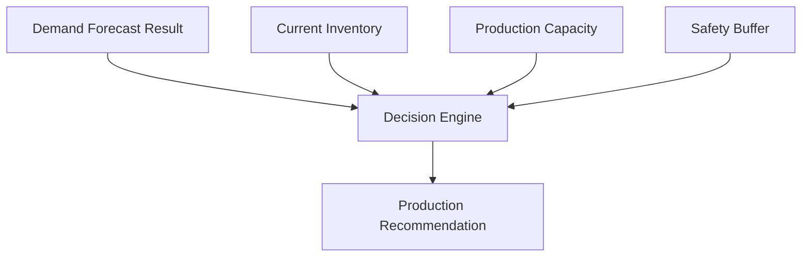

# SmartBiz AI V1.0 - Phase 5: AI Decision Engine Implementation

## Objective
The objective of Phase 5 is to transform forecasting results into actionable production recommendations for culinary UMKM users. The Decision Engine consumes forecasting outputs and combines them with operational constraints such as inventory, production capacity, and safety buffer to generate explainable recommendations.

## Architecture
The Decision Engine sits between the Forecasting Model and the User Interface.



**Module Structure:**
- `src/decision_engine/__init__.py`
- `src/decision_engine/production_optimizer.py`
- `src/decision_engine/recommendation_engine.py`
- `src/decision_engine/decision_rules.py`

## Algorithm
The production recommendation algorithm calculates the required production units while respecting constraints.

**Formula:**
`Recommended Production = Forecast Demand - Available Stock + Safety Buffer Adjustment`

## Decision Rules
1. **Rule 1**: IF `available_stock >= forecast_demand + safety_buffer`
   - THEN recommendation = "No additional production required"
2. **Rule 2**: IF `available_stock < forecast_demand + safety_buffer`
   - THEN recommend additional production quantity
3. **Rule 3**: IF recommendation exceeds production capacity
   - THEN adjust recommendation according to capacity limit
4. **Rule 4**: IF forecast uncertainty is high
   - THEN increase safety buffer by 10%

## Input-Output Example
**Input:**
- Forecast demand: 120
- Current stock: 30
- Production capacity: 200
- Safety percentage: 10%

**Output:**
```json
{
    "product": "P1",
    "forecast_demand": 120.0,
    "current_stock": 30.0,
    "production_capacity": 200.0,
    "safety_percentage": 10.0,
    "forecast_uncertainty": "low",
    "recommended_production": 102,
    "status": "Increase production",
    "reason": "Production recommendation increased because predicted demand is higher than current inventory availability."
}
```

## Testing Result
All tests successfully passed validating:
- Forecast higher than stock recommendations
- Stock higher than forecast handling (No production needed)
- Production exceeding capacity constraints
- Safety buffer calculations (including high uncertainty adjustment)
- Full decision pipeline execution generating JSON and CSV results.

Integration experiments are written successfully to `results/decision_engine/`.
